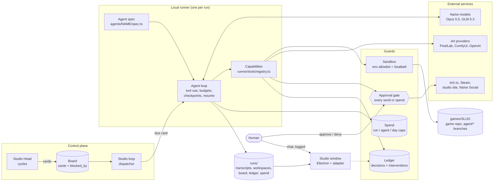
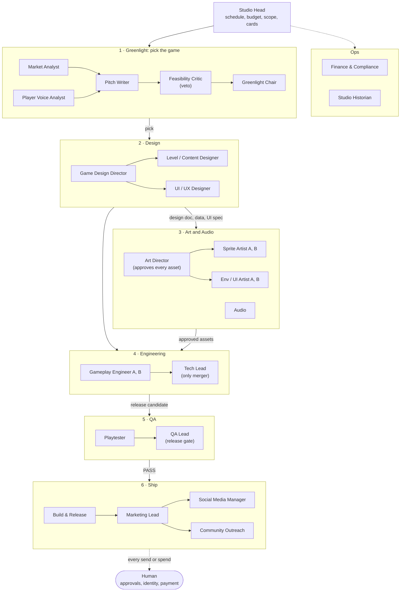

# any-co game studio

A game studio run by agents, built for the Naïve Autonomous Company Hackathon (YC SF, Sat Nov 7 1:00 PM PT to Sun Nov 8 11:00 AM PT).

Given a budget and the Steam catalog, the studio picks a game the market is missing, designs it, makes the art and code, tests it, markets it, and ships it. A human handles only identity and payment setup, and every intervention after the event starts is logged.

This repo is the **harness**: the infrastructure the agents run on. It contains no game content. The studio's agents make the game, in their own repo under `games/`.

- Plan: [`docs/plan.md`](docs/plan.md)
- Decisions: [`docs/decisions.md`](docs/decisions.md)
- Naïve platform notes: [`docs/naive-notes.md`](docs/naive-notes.md)
- Overnight operations: [`runbook.md`](runbook.md)

## What's here

| Path | What it is |
|---|---|
| `agents/` | One folder per agent: `spec.ts` (model, tools, budget, runner) and `system.md` (prompt). The spec is the source of truth for both runners. See [`agents/README.md`](agents/README.md). |
| `runner/` | The local agent loop (tool use, budgets, approval gate, crash recovery, kill switch) and the Naïve adapter. |
| `tools/` | Tools the agents use: Steam catalog queries, gap map, Greenlight, Steam reviews, and the decision and intervention ledger. |
| `window/` | The studio window, an Electron app for watching the studio run. See [`window/README.md`](window/README.md). |
| `scripts/` | Run one agent, validate specs, evals, Naïve connection check. |
| `docs/` | Plan, platform notes, game contracts, decisions. |

The studio has 26 agents across Greenlight, design, art, audio, engineering, QA, marketing and ops, led by a Studio Head. See [Agent setup](#agent-setup).

## How it works

- Each agent is a spec with a required USD budget. Agents run **locally** (our loop, any provider) or on **Naïve** (hosted), chosen per agent with `runner: local | naive`.
- Local runs are capped per run, per agent per period, and globally per day. Spend is recorded in `runs/spend.jsonl`.
- Every send or spend goes through the approval gate and is written to the ledger.
- Mechanical work (budget math, palette lock, schema checks) is deterministic code. Models only make judgment calls.
- Each run writes `runs/<run_id>/` with its transcript, output and workspace.

## Tech stack

| Layer | What we use |
|---|---|
| Harness and runner | TypeScript on Node 22 (`tsx`), `zod` for spec and output schemas, `undici` for HTTP with connection-pool recovery |
| Agent platform | [Naïve](https://usenaive.ai) via `@usenaive-sdk/managed-agents`: model catalogue, hosted agents, board, Files, approvals, studio site (Naïve App), Naïve Social |
| Models | Claude Opus 5.5 for engineering, game design and UI/UX; GLM 5.3 for everything else; GLM 5.3 Flash for the toy test agent |
| Art generation | PixelLab, ComfyUI on two homelab GPU lanes (RTX 3080 and RTX 4060, least-queue routing), OpenAI image generation (opt-in, capped), and a procedural fallback |
| Art post-processing | Deterministic code: palette lock, grid snap, outline, sprite strips and sheets, and an art gate (palette, style similarity, luma) |
| Game engine | Godot 4 (GDScript), web and Windows exports |
| QA | A contract driver for the game (`docs/contracts/`): seeded smoke runs, determinism, softlock checks, UI lint and an export check |
| Media | `ffmpeg` for gameplay capture, trailers and GIFs |
| Data | Steam catalog in SQLite (Python standard library), embeddings plus UMAP (`umap-js`) for the market gap map |
| Publishing | itch.io (`butler`), Steam staging (`steamcmd` package), the studio site on Naïve, Naïve Social |
| Studio window | Electron 44, React 19, Vite 8, Tailwind CSS 4, React Router, Storybook 10, and a Node adapter that serves `runs/` read-only |
| Safety | macOS Seatbelt (`sandbox-exec`) around agent-run code, env allowlists, the approval gate and the intervention ledger |

## Architecture



- **The board drives everything.** The Studio Head writes cards with `blocked_by` dependencies. The studio loop (`npm run studio`) claims each due card and starts the matching agent. Every run writes `runs/<run_id>/` with its transcript, output and workspace. The board is local or on Naïve (`STUDIO_BOARD=local|naive`).
- **One spec, two runners.** The local runner and Naïve read the same spec (prompt, model, tools, budget). Each agent can be cut over to Naïve on its own.
- **Agents work in clones.** Each run gets its own clone of the game repo on an `agent/<name>` branch. Only the Tech Lead merges to the game's `main`; art-only branches are merged by deterministic code.
- **Cards hand off files.** A card's output goes to `runs/handoff/<card>/` and arrives in the next card's workspace under `upstream/<card>/`.
- **Guards are code, not prompts.** Budgets are enforced per run, per agent per period and per day. Sends and spends pause at the approval gate for a human. Agent-run code (builds, QA, capture) runs sandboxed with a scrubbed env. Every human action is logged as an intervention.
- **Recovery.** Runs checkpoint and resume after a crash, network retries rebuild a poisoned connection pool, and `touch runs/KILL` stops all spend.

## Agent setup



Greenlight picks the game from market gaps and player reviews, Design turns the pick into a design doc and data, Art and Audio make assets against a locked style bible, Engineering builds behind a single merger, QA gates every release candidate, and Build & Release and Marketing ship it. Every public send waits for a human at the approval gate.

| Dept | Agents | Model |
|---|---|---|
| Head | Studio Head | GLM 5.3 |
| Greenlight | Market Analyst, Player Voice Analyst, Feasibility Critic, Greenlight Chair | GLM 5.3 |
| Design | Pitch Writer, Level/Content Designer | GLM 5.3 |
| Design | Game Design Director, UI/UX Designer | Opus 5.5 |
| Art | Art Director, Sprite Artist A/B, Env/UI Artist A/B | GLM 5.3 |
| Audio | Audio | GLM 5.3 |
| Engineering | Tech Lead, Gameplay Engineer A/B | Opus 5.5 |
| Engineering | Build & Release | GLM 5.3 |
| QA | QA Lead, Playtester | GLM 5.3 |
| Marketing | Marketing Lead, Social Media Manager, Community Outreach | GLM 5.3 |
| Ops | Finance & Compliance, Studio Historian | GLM 5.3 |

Budgets per task and per day are in each spec; `npm run agents -- list` prints them.

## Setup

Needs Node 22 or newer and Python 3.9 or newer (the Python tools use only the standard library).

```bash
npm install
cp .env.example .env     # fill in NAIVE_API_KEY and the provider keys you need
npm run naive:check      # confirm the Naïve connection
```

The Steam catalog goes in `data/` (gitignored). Read `data/README.md`, then run `python3 tools/catalog/prep.py`.

## Common commands

```bash
npm run agents -- list                     # list agent specs
npm run agents -- validate                 # check every spec
npm run agent -- <name> --task "..."       # run one agent locally -> runs/<run_id>/
npm test                                   # runner, tools and window adapter tests
npm run typecheck

npm run window:live:electron               # desktop window on real runs/
touch runs/KILL                            # kill switch: stop all spend (remove the file to resume)
```

## The studio window

`npm run window:live:electron` opens the studio window against the real `runs/` and `agents/`. It has the org chart, a live pulse of what each agent is doing, every run's loop, spend, and chat with the Studio Head. Chat is the one write path, and each message is logged as an intervention. See [`window/README.md`](window/README.md).

## Rules for this repo

- Harness and infrastructure only. No game concepts, design docs, art, store copy or game code, and never write inside `games/`.
- Every agent spec declares a budget.
- After Sat Nov 7, 1:00 PM PT, any change to this repo is a human intervention. Log it with a one-line reason.
- Secrets come from env or the Naïve vault, never from commits.

Coding agents: read [`CLAUDE.md`](CLAUDE.md) first.
